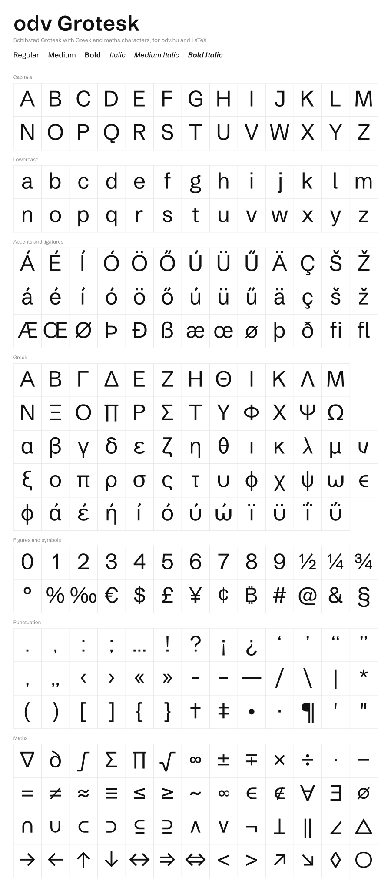

# odv Grotesk

A modified Schibsted Grotesk family, extended with Greek and maths characters.
Primarily designed for odv.hu and LaTeX writing.



[Schibsted Grotesk](https://github.com/schibsted/schibsted-grotesk) covers Latin but has only eight Greek letters (Δ Π Σ Ω α β μ π) and a partial set of maths symbols.
That is enough for a website, not for technical writing with ζ, χ, κ and ∇ in it.
odv Grotesk adds the missing characters in the same style, and reshapes a few letters (below). 
Everything else is as it was (each release contains more and more personalisation).
It is an independent modified version under the Open Font License, not affiliated with Schibsted.

## What is added

| | |
|---|---|
| Greek capitals | Γ Θ Λ Ξ Φ Ψ, plus Α Β Ε Ζ Η Ι Κ Μ Ν Ο Ρ Τ Υ Χ (same shapes as the Latin letters) |
| Greek lowercase | γ δ ε ζ η θ ι κ λ ν ξ ο ρ σ ς τ υ φ χ ψ ω, plus ϵ and ϕ (the symbol forms LaTeX uses for `\epsilon` and `\phi`) |
| Greek accents | ά έ ή ί ό ύ ώ ϊ ϋ ΐ ΰ, Ά Έ Ή Ί Ό Ύ Ώ Ϊ Ϋ, ΄ ΅ (monotonic). Combining accents sit on every Greek letter |
| Maths | ∇ ∈ ∉ ∀ ∃ ∓ ⋅ ∼ ⊥ ∩ ∪ ⊂ ⊃ ⊆ ⊇ ∧ ∨ ⇒ ⇔ ∝ ∥ ∠ △ |

Styles: Regular, Medium, Bold and their italics (Schibsted's static weights, not the variable font).
Still missing: the rest of the maths symbols (they come when a text needs them - we deal with mostly building physics-related problems, consider our use case limited).

## What is changed

| | |
|---|---|
| I | no serifs: a plain stem, spaced like the stem of H |
| e | the end of the lower stroke is cut level, so the opening is a horizontal slot |
| a | the top of the bowl runs flat out from the stem and turns down in a corner whose curvature eases in from the flat and out into the bowl, with no point where the bend starts. The terminal at the top is cut level at the height of its tip (upright styles. The italic a is single-storey and unchanged) |
| c | both terminals cut level |
| s | both terminals cut level at the height of their inner corners, like e and c, and 3% wider (its stroke weights kept), so it does not read small beside z |
| C G S J 2 3 5 6 9 | the same: every curved terminal cut level at the height of its inner corner, the outer edge carried on (the tabular figures, superiors and fractions follow) |
| terminals | a curved stroke cut level (c e s C G S J 2 3 5 6 9) does not swell into its end: from the top or bottom of its bowl the outer edge eases in, so the end is a little under halfway (0.45) from the thin to the side of o, O or 0 |
| r | the arm ends in a vertical cut, like the flags of f j y t. The cut stands at the tip of the arm, so the r keeps its reach and spacing |
| i j | square dot, top level with the top of l, overhanging the stem by the same amount on each side in every weight (so relatively less in heavier weights). It is the same glyph as the dot accent and the dieresis, so ä ö ü ż İ turn square too |
| i j | stems a touch heavier than n's (4.5%), so they don't read thin next to round letters: i and j match |
| p | counter moved right so stem and bowl are equally thick, which widens the join |
| f t (italics) | the upright f and t slanted, instead of the cursive forms |
| . , ! ? | square dots, the size of i's, and a comma with a square head and a straight tail leaning left, cut level (: ; … · ŀ and the quotes ‘ ’ “ ” ‚ „ are made of them and follow) |
| contrast | Medium and Bold (and their italics) have thinner verticals, so horizontals no longer look thin next to the stems: thin to thick is 0.87 in every weight, about what Schibsted drew its own Italic with. The tops and bottoms of rounds run into short smooth curves instead of the point the thinning would leave, and crotches (b d p q n h m u r a, 6 9 & $) stay a point instead of opening into a short flat. Where an arch or bowl meets a straight stem (n h m u r, b d p q), the arch is thinned less and less towards the stem, so the junction keeps Schibsted's weight |
| z E F T Z L H | in Medium and Bold the straight bars back to Schibsted's proportion to the thinned stem (about 0.85), so these letters are not darker than the rest |
| spacing | the bowls of b p þ and d q, and the shoulder of h, have the room Schibsted gave them only in kerned pairs in their sidebearings, so pairs it did not kern (`od`, `bd`, `hu`) sit like the rest. The 1 is a little tighter on the left: its light flag no longer leaves a hole before it, as in 1911 |
| kerning | no letter is kerned further from a round than from a stem: lowercase rounds (o b p e c s before o d c e q a s), capital rounds (O D Q C G S B P before O C G Q S) and the figures among themselves, so `pod`, `OCO` and `1960` sit evenly. z is pulled half as close to o c e s. The en dash keeps from a figure the distance one 0 keeps from the next, so year ranges such as 1967–2026 are not crowded (set dates in the default figures; tabular figures, `tnum`, are for columns) |
| corners | where a straight edge turns through a quarter into another by way of a curve (the hooks of f j t y l, g's ear, a's spur, { } ∫ ƒ, the drawn ζ ξ ς τ), the curve is redrawn so its curvature rises from nothing and falls back to nothing, with no point where the bend starts. It starts where the old curve did |
| curves | Schibsted's own small kinks straightened and curvature steps between quadratic pieces evened out, in every glyph. Smooth points stay smooth when rounded to whole units |

Accented forms (Í, é, ą, ç…), IJ, the fi ligatures and Greek Ι are built from these glyphs and follow them. Č č Ě ě ř Š š Ť Ž ž ǎ Ǧ, which Schibsted draws as single outlines, are rebuilt as the letter and its caron so they follow too.
The changes are recipes in [`scripts/modify.py`](scripts/modify.py) (the terminal taper in [`scripts/taper.py`](scripts/taper.py), the eased corners in [`scripts/fair.py`](scripts/fair.py)), applied to each style at build time.

## Download

Built fonts are on the [Releases page](https://github.com/odv-hu/odv-grotesk/releases), one release per version: `odvGrotesk-*.woff2` for the web, `odvGrotesk-*.ttf` for macOS and LuaLaTeX, `odvMath-Regular.otf` / `.woff2` (the maths font, below), or a zip with all of them and their licences.
They are not kept in git.

To release a version: set `VERSION` in `scripts/build.py`, add its entry to `FONTLOG.txt`, commit, then push the tag `v<version>`.
[`.github/workflows/release.yml`](.github/workflows/release.yml) builds every style from the committed UFOs and publishes the release with the FONTLOG entry as notes.
It never replaces an existing release.

## How it is made

The new glyphs are drawn by [`scripts/draw.py`](scripts/draw.py) from recipes rather than by hand:
κ is k cut at the x-height, ρ is the bowl of p with a stem, ∇ is Δ turned over, ⇒ is → with the shaft doubled, and letters with no Latin relative (ζ, λ, ψ, Ψ…) are stroked along a centre line.
Stem widths, heights and sidebearings are measured from each style of the font, so the same recipes produce every weight and the italic.
The result goes into `sources/<style>.ufo`, which opens in any font editor.
A glyph finished by hand goes into `sources/hand-edited.txt`, and the script leaves it alone from then on.

The spacing is evened out from Schibsted's own numbers: where it kerns a letter further than its model against nearly everything (d 16-18 units further than o, h about 28 further than n), [`scripts/space.py`](scripts/space.py) moves that into the sidebearing and takes it off the kerning again, so the pairs it kerned look as before and the ones it missed open up to match. [`scripts/kern.py`](scripts/kern.py) then caps the kerning of rounds at what the same letter gets against a stem.

The Greek letters are kerned like Latin letters with the same sides: [`scripts/kern.py`](scripts/kern.py) puts Τ in T's kerning classes, Λ in A's, Γ in E's on the left and T's on the right, and so on, so `ΓΑΤΑ` sits like `AVATAR`.

Accented Greek is built by [`scripts/accents.py`](scripts/accents.py): every Greek letter gets a top anchor (the Latin twin's, or centred over the top of the drawn glyph), so combining accents land on it, and the monotonic letters ά…ώ, Ά…Ώ are composites of the letter and the font's own acute and dieresis. On the capitals the tonos stands to the left. In ΐ ΰ the dots spread to let the acute stand between them.

[`scripts/build.py`](scripts/build.py) downloads the pinned Schibsted Grotesk release, merges the glyphs from the UFOs, adds the Greek kerning, renames the family and writes:

- `fonts/ttf/odvGrotesk-*.ttf` for macOS and LuaLaTeX,
- `fonts/webfonts/odvGrotesk-*.woff2` for the website.

```sh
pip install -r requirements.txt
python3 scripts/build.py              # draw + build all styles
python3 scripts/build.py --no-draw    # build from the UFOs as they are (after hand edits)
python3 scripts/build.py Regular      # one style
python3 scripts/specimen.py           # redraw preview/glyphs.svg from the built fonts
```

## odv Math

The equations go with odv Grotesk in Computer Modern. **odv Math** is New Computer Modern Math Book enlarged to 112 %, the size at which odv-latex sets it next to the grotesk, so Keynote and odv.hu (where it can be MathML's `math` font) get the same size from the same file at its nominal size. [`scripts/odvmath.py`](scripts/odvmath.py) downloads the pinned New Computer Modern and changes only `unitsPerEm` (1000 → 893): the outlines, metrics and `MATH` table are New Computer Modern's. It is renamed and keeps its own licence, the GUST Font License `GUST-FONT-LICENSE.txt` and `README-odvMath.txt` come with it in the release.

## Maths in LaTeX

odv Grotesk is a text font, not a maths font: it has no maths spacing, italic correction or script sizes, so equations stay in Computer Modern.
[odv-latex](https://github.com/odv-hu/odv-latex) (`odv.sty`) sets text in odv Grotesk and maths in Computer Modern enlarged to 112 %: odv Math when it is installed, New Computer Modern Book otherwise.
The Greek letters here are for running text, Keynote and the website.
[`preview/preview.tex`](preview/preview.tex) shows the glyphs, and equations in odv Math as `odv.sty` sets them.

## Licence

SIL Open Font License 1.1, see [OFL.txt](OFL.txt). Changes are logged in [FONTLOG.txt](FONTLOG.txt).
The original design is © 2023 The Schibsted-Grotesk Project Authors.
odv Math is under the GUST Font License, as New Computer Modern (© Antonis Tsolomitis, after Computer Modern by Donald E. Knuth) is.
